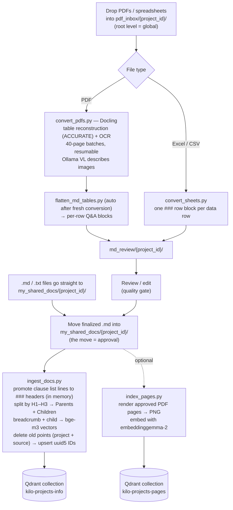
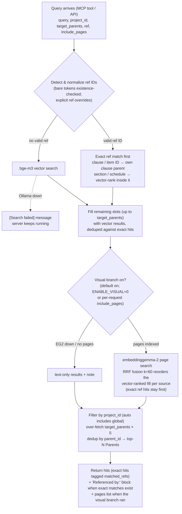

# Architecture

## Components

| Component | Description |
| --- | --- |
| Qdrant (`docker-compose.yml`) | Vector database; HTTP/Dashboard port `6333`, gRPC port `6334`, data stored in `qdrant_storage/` |
| Ollama + `bge-m3` | Text embedding model (1024 dims) for the chunk index; served at `localhost:11434` |
| Ollama + `embeddinggemma-2` | Multimodal page-image embedding model (768 dims) for visual retrieval; served at `localhost:11434` |
| `rag_core.py` | Shared core logic (paths, conversion, chunking, ingestion, search) used by the CLI scripts, the MCP server and the web API |
| `convert_pdfs.py` | PDF→Markdown conversion script (Docling); converts `pdf_inbox/` into reviewable Markdown in `md_review/` — thin CLI wrapper over `rag_core` |
| `convert_sheets.py` | Excel/CSV→Markdown conversion script (`.xlsx`/`.xlsm`/`.csv`); converts `pdf_inbox/` spreadsheets into reviewable Markdown in `md_review/` — thin CLI wrapper over `rag_core` |
| `sheet_to_md.py` | Spreadsheet→Markdown module used by `convert_sheets.py`: header detection, merged-cell expansion, one `### {row}` block per row; standalone use: `python sheet_to_md.py <file...>` prints to stdout |
| `flatten_md_tables.py` | Post-processing script: rewrites Markdown pipe tables into one `### {Item ID}` Q&A block per row (auto-run by `convert_pdfs.py` after fresh conversions; can also be run manually, e.g. `python flatten_md_tables.py md_review/`) |
| `ingest_docs.py` | Ingestion script: md/txt sources → Parent-Child chunking, vectorization, upsert into Qdrant — thin CLI wrapper over `rag_core` |
| `index_pages.py` | Page-image indexing script: renders approved PDFs' pages to PNGs and embeds them with `embeddinggemma-2` for visual retrieval — thin CLI wrapper over `rag_core` |
| `rag_mcp_server.py` | FastMCP stdio server exposing `search_shared_knowledge(query, project_id, target_parents=3, ref=None, include_pages=False)` |
| `ref_ids.py` | Pure-function reference-ID model used at ingest and query time: clause-header promotion, breadcrumb/mention ID extraction, query ref normalization (`PS 1.2.3`, `Section 12`, `Schedule 2`, `AB1-C2` → canonical IDs) |
| `api/` | Optional local FastAPI service (port `8100`) wrapping the whole workflow for the web UI: projects, upload, convert/ingest jobs, review editing, approval, search |
| `web/` | Optional Next.js web UI (App Router, TypeScript, Tailwind) driving the workflow through `api/` |

## Data Flow (Ingest)

1. Drop PDFs and Excel/CSV spreadsheets (`.xlsx`/`.xlsm`/`.csv`) into `pdf_inbox/{project_id}/` (root-level files = `global`, mirroring `my_shared_docs`)
2. Run `python convert_pdfs.py` → Docling converts them to reviewable Markdown in `md_review/{project_id}/` (table reconstruction in ACCURATE mode, built-in OCR; written incrementally in 40-page batches and resumable after interruption); images are described by the Ollama VL model as `[Image]: <description>` paragraphs; after each fresh conversion, table flattening runs automatically (see `flatten_md_tables.py` below). For spreadsheets run `python convert_sheets.py` instead → each sheet becomes a `# {filename} — Sheet: {name}` section with one `### {row}` block per data row (same block convention as the flattened PDF tables; no flattening step needed)
3. **Review / edit the Markdown in `md_review/`** — this is the quality gate before anything is indexed
4. Move the finalized `.md` into `my_shared_docs/{project_id}/` — the move itself is the approval signal
5. Run `python ingest_docs.py` (md/txt only): dotted clause list lines (`- 1.2.3 The ...`) are first promoted to `### <id>` headers in memory (never touching the files on disk) so each clause becomes its own retrieval unit, then `MarkdownHeaderTextSplitter` splits by H1–H3, Parents (12000/0) and Children (300/50); embedding text = header breadcrumb + Child content, vectorized by bge-m3; idempotent uuid5 point IDs are upserted into the `kilo-projects-info` collection, with keyword payload indexes on `project_id`, `parent_ref_ids` (own section/clause IDs on the breadcrumb path) and `mentioned_refs` (IDs referenced in the parent text). Each file's previous points are deleted (filter: project + source) right before its upsert, so re-ingesting an edited file leaves no stale chunks
6. *(Optional)* Run `python index_pages.py` to page-index the approved PDFs for visual retrieval (same review gate; see [Visual Retrieval](VISUAL_RETRIEVAL.md))

## Query Flow

1. Reference IDs in the query (`PS 1.2.3`, `Clause 1.2.3(d)`, `Section 12`, `Schedule 2`, `Sch.4`, `SC No. 2`, `AB1-C2`, `1234-56`) are detected and normalized (bare dotted/alphanumeric tokens only after an existence check against the index, so standard numbers like `IEC 61010-1` are ignored); an explicit `ref` parameter overrides detection
2. Exact ref matches come first: deep clause IDs (≥3 segments) and alphanumeric item IDs return their own clause parent; section/schedule/2-segment IDs vector-rank children within that section and return its top clauses
3. Remaining slots (up to `target_parents`) are filled with plain vector results, deduplicated against the exact hits; hits from exact matches are tagged `matched_refs`
4. When exact matches exist, a `Referenced by:` block lists the source files mentioning the matched ID (reverse citation lookup for compliance work)
5. The query is vectorized by bge-m3, results are filtered by `project_id` (automatically includes `global`), over-fetched `target_parents * 5`, deduplicated by `parent_id`, and complete Parent sections returned (default 3); if Ollama is not running, returns a `[Search failed]` message and the MCP Server does not crash
6. *(Visual branch, default on)* the query is also embedded by `embeddinggemma-2` and matched against indexed page images; a `pages` list of page hits is returned alongside, and the vector-ranked fill of `hits` is re-ordered by RRF fusion (k=60) per source — exact ref hits are never displaced; embedder down → text-only results plus a note (see [Visual Retrieval](VISUAL_RETRIEVAL.md))

## Key Features

- **Parent-Child (Small-to-Big) retrieval**: small chunks (Children) are used for semantic matching, and complete large sections (Parents) are returned
- **Section-ID search**: compliance-style references (`PS 1.2.3`, `Section 12`, `Schedule 2`, `AB1-C2`) are matched exactly against indexed clause/section IDs and returned as the first hit, with a Referenced-by reverse citation block — no vocabulary guessing needed; pure-text queries keep the unchanged vector behavior
- **Clause-level parents**: dotted clause list lines are promoted to headers at ingest time (in memory only), so a clause like 1.2.3 is its own retrieval unit instead of being buried in a section grab-bag
- **Header-aware chunking**: sections split by Markdown headers; embedding text includes the `H1 > H2 > H3` breadcrumb
- **Docling preprocessing**: table structure reconstruction and OCR, with resumable batch conversion and a review gate before ingestion
- **Image descriptions (Ollama VL)**: images found in converted PDFs are described by a local vision-language model (`qwen3.8:27b-mlx`) with a structured-caption prompt (visual kind, title/subject, axes/series/units/numbers, components/connections, labels); each `<!-- image -->` placeholder becomes an `[Image]: <description>` paragraph, so image content is searchable. If Ollama or the model is unavailable, the placeholder is kept and the conversion still completes
- **Visual retrieval (page-as-image)**: approved PDFs' pages are rendered to PNGs and embedded with multimodal `embeddinggemma-2`; searches RRF-fuse the text and page rankings and return page hits with clickable thumbnails — see [Visual Retrieval](VISUAL_RETRIEVAL.md)
- **Table flattening**: pipe tables (e.g. Item/Question/Reply Q&A tables) are rewritten into one `### {Item ID}` Q&A block per row, so each Q&A becomes a self-contained retrieval unit; cross-page continuation rows are merged per column, `(Cont'd)` rows folded into their base item, repeated page headers deduplicated, and HTML entities unescaped. Headerless tables are flattened without invented labels (truncated first-column titles, plain-text lines)
- **Idempotent reruns**: point IDs are derived from filename and chunk indices; rerunning overwrites old data instead of stacking duplicates
- **Ollama failure tolerance**: friendly error messages on query failure; the MCP Server keeps running

## Directory Overview

- `pdf_inbox/` — Drop PDFs and Excel/CSV spreadsheets to convert here (root = `global`, first-level subfolders = `project_id`)
- `md_review/` — Conversion output awaiting review; edit here, then move the finalized `.md` into `my_shared_docs/`
- `my_shared_docs/` — Approved document source (root = `global`, first-level subfolders = `project_id`)
- `pages/` — Rendered page PNGs for visual retrieval (`{project_id}/{stem}/page-{nnnn}.png`; bind-mounted into the api container)
- `converted_md/` — Legacy conversion cache from the old single-script workflow (safe to delete; keep `02-Particular-Specification-points-list.md` if still needed)
- `qdrant_storage/` — Qdrant data directory (Docker bind mount)
- `rag_core.py` — Shared workflow core (used by CLI, MCP server and web API)
- `ref_ids.py` — Reference-ID model for section-ID search (promotion, ID extraction, query normalization)
- `convert_pdfs.py` — PDF→Markdown conversion script (review gate)
- `convert_sheets.py` — Excel/CSV→Markdown conversion script (review gate)
- `sheet_to_md.py` — Spreadsheet→Markdown module (header detection, merged-cell expansion, per-row blocks)
- `flatten_md_tables.py` — Table flattening script (auto-run after fresh conversions; `python flatten_md_tables.py md_review/` migrates existing files in place)
- `ingest_docs.py` — Ingestion script (documents → chunks → vectors → Qdrant)
- `index_pages.py` — Page-image indexing script (approved PDFs → PNGs → EG2 vectors → Qdrant page collection)
- `rag_mcp_server.py` — MCP Server (provides the retrieval tool)
- `api/` — FastAPI app (`api/app.py`) + job manager (`api/jobs.py`) for the web UI
- `web/` — Next.js web UI (see [Web UI](WEB_UI.md))
